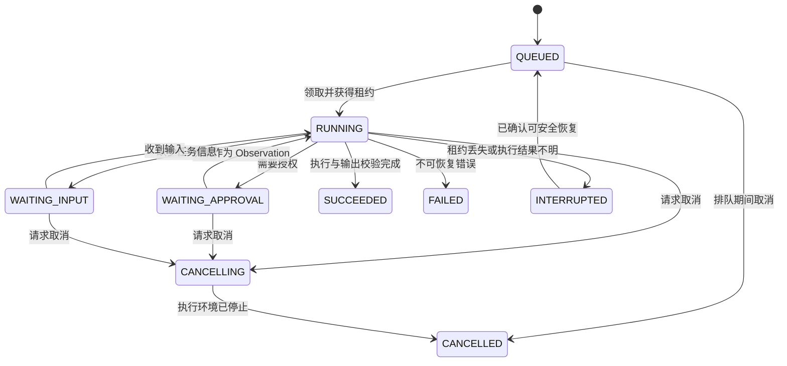

# Think-Act-Observe 执行引擎

状态：TAO 单层循环已实现。`apps/runner` 已实现独立单模型执行、租约、取消、只读工具、批准文件提案的受控应用，以及 Shell 提案、审批、bubblewrap 沙箱、systemd cgroup、逻辑工作区配额和结果不明终态；cgroup 部署验收、子 Agent 和完整检查点仍按阶段建设，见 [ADR-0006](../decisions/0006-background-chat-runner.md)、[ADR-0011](../decisions/0011-file-change-review.md) 与 [ADR-0012](../decisions/0012-sandbox-shell.md)。

## 主循环

1. 读取 Run 快照与检查点，验证调用者权限、剩余预算、取消状态和执行租约。
2. 构建上下文：用户目标、必要历史、工具目录、摘要与已完成的子任务结果。
3. 调用模型获得公开执行摘要、最终输出或结构化工具调用。
4. 校验工具名与参数，执行确定性策略；允许、拒绝或持久化审批请求。
5. 审批通过后再次核对操作摘要与有效权限，在隔离环境执行。
6. 保存工具状态、结果/产物与事件，作为 Observation 供下一轮使用。
7. 检查完成条件、超时、Token/步数/费用限额，再继续或终止。

模型没有继续调用工具只代表停止推演，Run 是否通过验收还需结果 Schema 和任务验收规则判断。Think 是控制流程概念，不要求模型输出私有思维链。

## 状态机

超时/预算耗尽进入 FAILED 并记录明确原因；等待审批/输入有独立期限。审批拒绝可以返回 Observation，让 Agent 在剩余权限中调整计划；不能自动重新发起相同操作绕过拒绝。CANCELLING 未确认进程停止时不能标为 CANCELLED；停止结果不明进入 INTERRUPTED。状态迁移使用条件更新，拒绝过期执行者写回。

## 子 Agent

MVP 一层 Supervisor-Worker：主 Agent 发起异步子 Run，获得句柄，继续独立工作；需要时等待并收集结构化结果。子 Run 有自己的事件流、错误、产物与配置快照。

子任务的有效权限是父任务与子配置的交集；并发、Token、费用和总时长受整棵任务树预算约束。取消向下传播。父任务不得在必需子任务尚未完成时报告整体成功。先并行只读任务，写任务串行或使用独立目录；Git worktree 提供变更隔离，不能替代进程/权限隔离。

## 上下文与恢复

工具输出按大小截断并保存完整产物；压缩保留目标、约束、已执行动作、关键来源与待办。摘要之外保留原始消息和边界编号，避免重复消费结果。

工具调用具有 prepared、executing、completed、failed、outcome_unknown 等持久化状态。崩溃后对只读/有幂等键操作按策略恢复；外部写操作结果不明时先查询状态或人工处理，禁止盲目重放。任务租约与检查点必须先落地，再宣称支持断点恢复。
