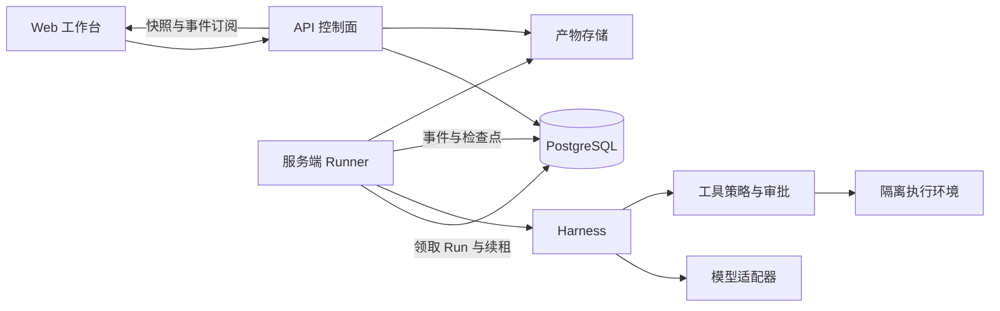

# 架构总览

状态：目标架构。现有代码只包含 Web → 健康检查 API，不包含下图中的业务运行能力。

## 模块与依赖

- `apps/web` → `packages/contracts`。
- `apps/api` → `packages/contracts`、自身业务模块和持久化适配器。
- `apps/runner` → `packages/runtime`、`packages/tools`、`packages/contracts`。
- `packages/runtime` 只依赖契约与抽象端口；模型、工具、事件、检查点由 Runner 注入。
- `packages/tools` 提供策略与执行适配，不反向导入任何应用。

初期采用模块化单仓库，Web 与 API 独立构建；Runner 在实际执行里程碑成为独立进程，保持凭证和操作系统权限边界。MVP 使用 PostgreSQL 保存业务、事件与任务交接，不预置 Redis、向量数据库、消息集群。

任务领取使用事务/租约与心跳，确保一个 Run 只有一个有效持有者；取消与审批保存在库中。事件持久化后通知客户端，不能以 WebSocket 或内存 Map 作为唯一事实来源。

## 执行边界

服务端模式在私有部署的 Runner 工作区执行；LOCAL 模式未来通过已认证 Runner 连接本机目录。模型调用位置和工具执行位置分别配置，不能把“本地工具”解释为“数据绝不离开本机”。

Web/API 与执行环境分离；Shell 容器不得挂载 API 配置、数据库凭证或容器管理 socket。Runner 管理权限只授予受信任的调度组件。

## 目录演进

新增功能优先进入既有领域，只有出现明确复用与依赖边界时再拆包。数据库方案先放 `database/`；审计、审批仍可作为 API 领域模块，无需提前拆微服务。LOCAL Runner、外部连接器和运维观测按需求新增。
