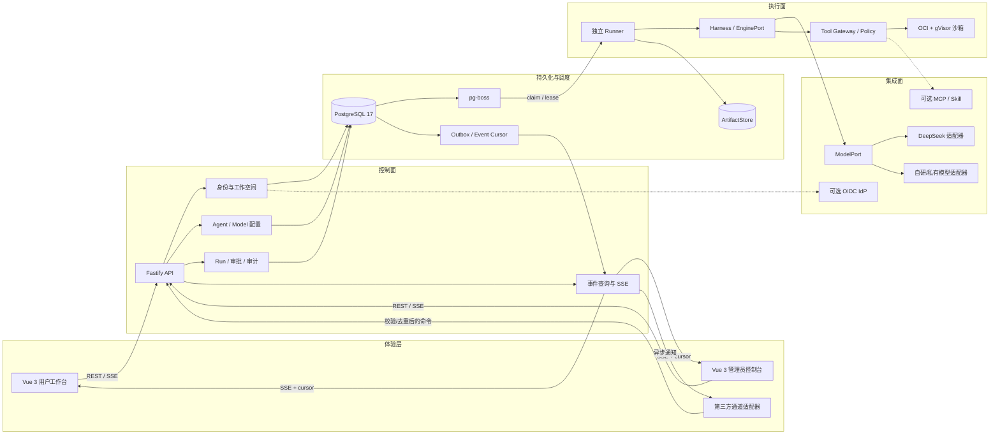
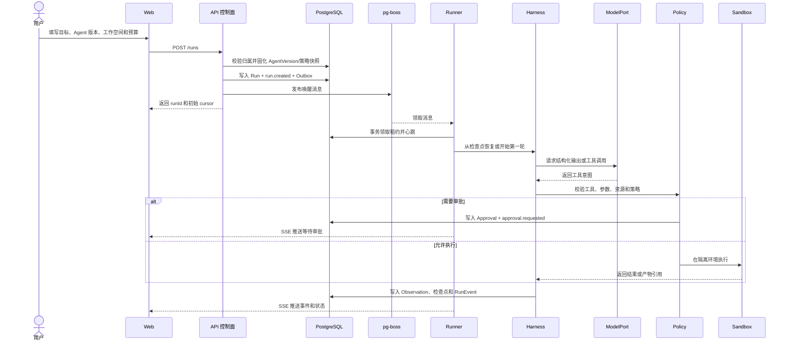

# 技术架构总设计

状态：v0.3 目标架构。当前已实现用户/管理员 Web、身份配置、模型适配、持久化 Run、TAO 只读工具、SSE、文件变更与 Shell 命令的持久化审阅，以及独立单模型 Runner；实际依赖图与协议见 [ADR-0006](../decisions/0006-background-chat-runner.md)、[ADR-0011](../decisions/0011-file-change-review.md) 和 [ADR-0012](../decisions/0012-sandbox-shell.md)。生产级资源隔离、网页工具和多 Agent 按阶段实现。

## 设计目标

架构需要同时支持私有化部署、多 Agent 协作、长任务恢复和受控工具执行。核心取舍是把任务事实、权限判断和副作用执行放在服务端可追溯的边界内，同时保留替换模型供应商、执行环境和对象存储的能力。

- Web 只负责展示状态和发起命令，不能成为任务状态或权限的事实来源。
- API 控制面负责身份、配置、任务命令、审批和审计查询；它不直接执行用户 Shell。
- Runner 执行租约中的 Run，Harness 推进 Think-Act-Observe，工具管线在副作用前完成参数校验、策略和审批。
- PostgreSQL 保存业务状态、事件、检查点、租约和 Outbox；pg-boss 只负责唤醒工作，不能替代业务状态。
- 产物通过 ArtifactStore 管理，默认本地目录，生产可替换为 S3 兼容对象存储。
- 所有模型、工具、策略、执行器和外部连接通过端口（Port）接入，供应商类型不得泄漏到领域模块。

## 分层和部署单元



### 控制面

API 采用模块化单体，按领域划分 `identity`、`workspaces`、`agents`、`models`、`runs`、`approvals`、`artifacts` 和 `audit`。每个领域拥有自己的应用服务、端口和仓储接口；跨领域操作由应用服务协调并在一个明确的事务边界内写入状态和事件。

控制面只创建 Run、生成 AgentVersion 快照、记录审批和发布取消信号。它不会导入 Shell 执行器、模型供应商 SDK 或沙箱客户端，避免 HTTP 请求路径绕过执行策略。

### 执行面

Runner 是独立进程，使用租约领取待执行 Run，定期续租，并在取消、超时或租约失效时停止继续领取调用。Runner 组装 `EnginePort`、`ModelPort`、`ToolPort`、`CheckpointStore` 和 `ArtifactStore`。

Harness 维护单次模型轮次和工具调用状态。LangGraph JS 只通过适配器接入，框架对象不进入领域模型。将来更换为自研薄循环或其他编排框架时，Run、Step、ToolInvocation 和事件协议保持不变。

### 数据面

PostgreSQL 是 Run、事件、审批、租约和审计的事实来源。关键状态变更和领域事件在同一事务中提交，Outbox 投递失败不会丢失已经完成的业务状态。事件按 `runId + sequence` 排序，客户端通过游标补齐断线期间的事件。

ArtifactStore 只保存文件或大输出，数据库保存引用、散列、大小、类型、来源 Run 和授权元数据。下载必须经过对象归属检查，不能把产物目录直接映射为公开静态目录。

## 核心数据流

### 创建和执行 Run



### 审批和恢复

审批绑定单次 `ToolInvocation`、规范化参数摘要、资源范围、策略版本和过期时间。批准后 Runner 必须重新校验当前权限和参数摘要；任何参数、目录或策略变化都会生成新的审批请求。

Runner 崩溃时，租约过期触发重新领取。恢复先读取最后一个检查点，再检查每个工具调用的持久化状态：只读或具有幂等键的调用可以按策略恢复；外部写入处于 `outcome_unknown` 时先查询或转人工，不自动重放。取消在执行环境确认停止前保持 `CANCELLING`。

## 模块依赖规则

```text
apps/web -> packages/contracts
apps/api -> packages/contracts + control-plane modules
apps/runner -> packages/contracts + packages/runtime + packages/tools
packages/runtime -> ports/contracts only
packages/tools -> policy ports + execution adapters
database adapters -> domain repositories only
```

领域模块只能通过应用服务或端口访问其他模块，不能跨模块直接读写 repository。`contracts` 只包含版本化 API、事件、错误和工具协议，不包含数据库实体、ORM 类型或供应商 SDK 类型。新增功能先进入已有模块，只有出现稳定复用和独立生命周期时才拆成 workspace 包或进程。

## 私有化部署拓扑

### 单机试点

Web、API 和 Runner 以独立容器运行；PostgreSQL、产物卷和反向代理使用持久化卷。模型连接、OIDC 和外部工具由服务端配置，密钥通过环境或密钥系统注入。Compose 只用于开发和单机试点，不能直接视为高可用方案。

### 多节点交付

API 可以横向扩展，Runner 按能力标签和工作空间策略扩展。PostgreSQL 仍保存租约和事件事实，Runner 通过 fencing 防止旧进程继续写入。达到跨天任务、多节点故障转移或独立扩缩容需求后再评估 Kubernetes/Helm；在此之前不引入微服务和消息集群增加运维面。

## 安全边界

有效权限为用户授权、工作空间策略、Agent 版本权限、Run 授权和 Runner 能力的交集；子 Run 再与父 Run 取交集。Shell 和网页工具运行在受限环境，默认无外网，不能挂载 API 配置、数据库凭证或容器管理 socket。详细规则见[安全与权限](security.md)。

## 质量属性与验收

| 目标       | 初始验收标准                                         | 归属阶段 |
| ---------- | ---------------------------------------------------- | -------- |
| 状态一致性 | Run 状态和对应事件事务提交；重复投递不重复副作用     | M2       |
| 可恢复性   | 断线用快照 + cursor 补齐；租约恢复不盲目重放外部写入 | M2/M4    |
| 安全性     | 跨空间访问、路径穿越、审批参数变更和沙箱逃逸测试通过 | M1/M3    |
| 可观测性   | Run、工具调用、审批、产物和管理操作可按 ID 追溯      | M2/M3    |
| 性能       | 控制 API P95 < 300ms；已连接事件投递 P95 < 1s        | M2 基准  |
| 私有化     | 新环境按文档完成安装、备份恢复和升级迁移             | M5       |

阶段进入/退出条件集中记录在[阶段门槛](../roadmap/phase-gates.md)。任何生产能力都必须同时更新接口契约、事件、权限、原型状态和测试证据。

## 实施顺序

1. PostgreSQL 迁移、User/Workspace/Membership、模型连接和 AgentVersion。
2. Run/Step/ToolInvocation/Artifact 领域模型、租约和事件游标。
3. `EnginePort` PoC，先接只读文件工具和离线模型样例。
4. 策略、审批、受限写入和沙箱；补齐恢复与结果不明语义。
5. 一层 Supervisor-Worker、预算树、取消传播和上下文压缩。
6. Compose 私有化交付、备份恢复、内网模型和升级手册。

每一步只引入已经被当前里程碑使用的依赖；选型变化通过 ADR 记录替代方案、验证结果和退出成本。
