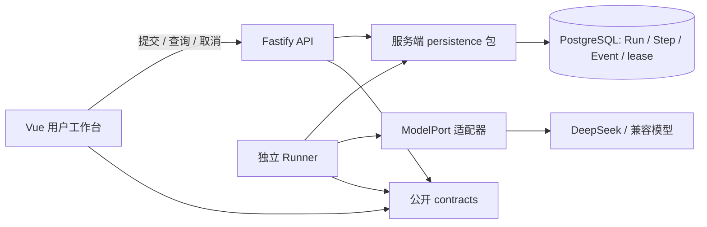

# ADR-0006：单模型对话的持久化交接

日期：2026-09-21。状态：采用，限 M2 单模型运行。调整 ADR-0003/0004 的初期唤醒方案；LangGraph/EnginePort 与受控工具的目标设计仍保留。

## 问题与选择

对话此前在 HTTP 请求内完成模型调用。刷新可以读取完成的历史，但 API 中断会遗留 running 状态，运行期间无法可靠取消或跟踪。

| 方案                     | 优点                                     | 代价                                           | 本次决定                                          |
| ------------------------ | ---------------------------------------- | ---------------------------------------------- | ------------------------------------------------- |
| API 内同步调用           | 实现简单                                 | 请求与执行耦合，没有独立租约                   | 移出用户对话路径；管理员连接测试仍可同步          |
| PostgreSQL 行锁队列      | 提交、状态和事件在同一库；无额外投递窗口 | 需要自行验证租约、竞争、超时；短轮询有固定负载 | 本次采用，单进程一个执行槽                        |
| pg-boss 唤醒 + Run 租约  | 后续定时和调度能力更完整                 | 需要协调事务投递和业务租约，两套恢复状态       | 保留候选；有多类工作/调度需求时再接入，替代唤醒层 |
| Redis/BullMQ 或 Temporal | 独立队列或长流程能力                     | 新增基础设施和一致性交接成本                   | 当前暂缓                                          |

API 与 Runner 都需要数据库 Schema、Run 事务和托管密钥解析，因此抽出 `packages/persistence`。比较了跨应用导入、重复 Schema 和共享服务端包，选择共享包以保持单一存储定义。它依赖 contracts、runtime 的密钥引用接口和 PostgreSQL 驱动；Web 禁止导入它，runtime 不反向依赖数据库。

## 本次协议与行为

- 预发布 `POST /api/v1/workspaces/:workspaceId/chat` 变为 `202`，返回 `sessionId/runId/stepId/status`。完成结果从 `GET /.../runs/:runId` 获取。API 与 Web 同版本发布；旧页面需要刷新。原同步 `200` 调用方须迁移。
- 提交事务写 queued Run、queued Step、`run.created/step.queued`。同一已有 Session 在行锁内检查活动任务，冲突返回 `409 session_busy`。首轮是新会话；客户端不自动重放结果未知的提交。
- Runner 使用 `FOR UPDATE SKIP LOCKED` 领取、随机 lease token 和 30 秒租约，每 2 秒续租。状态和事件事务提交，完成/续租必须持有未过期 token；过期执行者被拒绝。
- 默认单次模型输出上限 1024 Token（接口允许 1–8192），执行时长上限 60 秒。排队超过 5 分钟由运行中的 Runner 标记 `queue_timeout`；没有活跃 Runner 时会保持排队，直到恢复协调。
- 用户/工作空间身份和模型连接在执行前再次校验。模型配置快照不包含密钥；若排队后配置已变更则失败，避免把新凭证用于过期配置。
- 取消接口只允许原会话所有者调用。queued 可立即 cancelled；running 先记录 `cancelRequestedAt`，页面显示正在取消。只有本地模型请求结束后才写 cancelled。HTTP 取消不能保证供应商停止服务端计算或免除费用。
- 租约过期、无租约的旧同步 running 记录进入 failed。不会自动重试模型请求，避免重复费用或未知副作用。SIGTERM/SIGINT 会中止本地请求并记录停止原因；强制杀进程由下次租约检查收敛。
- 页面先保存 Run 所属 Session ID，再查询持久状态后继续跟踪；运行中优先订阅带 `Last-Event-ID` 的 Run 事件 SSE，连接失败回退到轮询。当前仍没有 Token 流，事件流只传递已持久化的状态事件。

## 当前依赖图

`persistence` 中的密钥解析依赖 runtime 的环境引用接口；运行循环和事件事实不进入浏览器。数据库迁移仍由 API 迁移 CLI 执行一次，Runner 不在启动时竞争执行迁移。

## 验收与边界

集成测试覆盖提交不触发模型调用、竞争领取一次、Session 串行、权限隔离、取消与重复取消、租约过期、过期 token 写回拒绝、模型配置变化、执行超时和优雅停止。浏览器回归覆盖排队后刷新、工作空间恢复、继续查询和取消确认。

本阶段只保证平台状态和执行者交接，不宣称供应商请求 exactly-once。TAO 工具台账、审批、自动恢复检查点、总预算树、进程高可用和多 Agent 仍按后续阶段验收。
